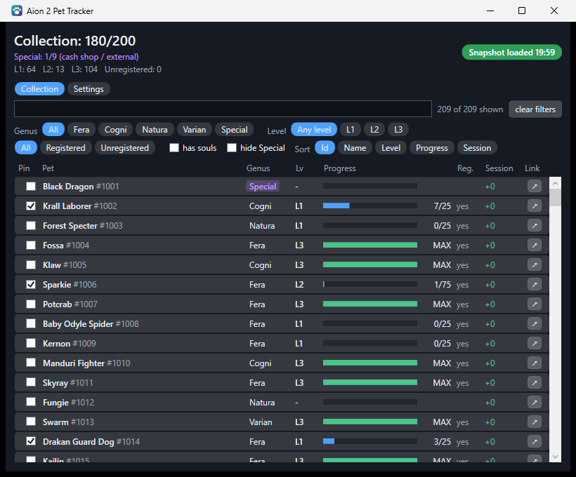
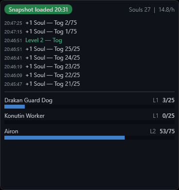
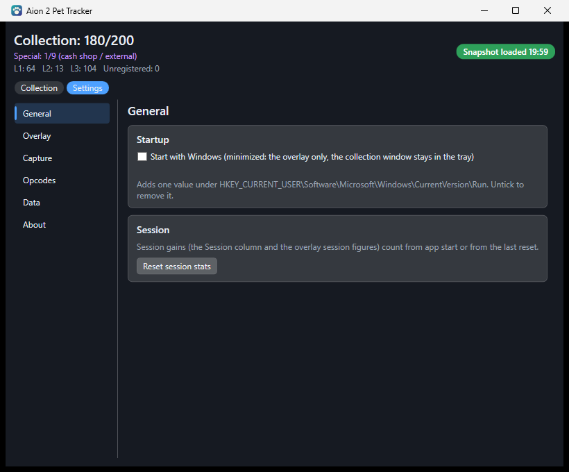
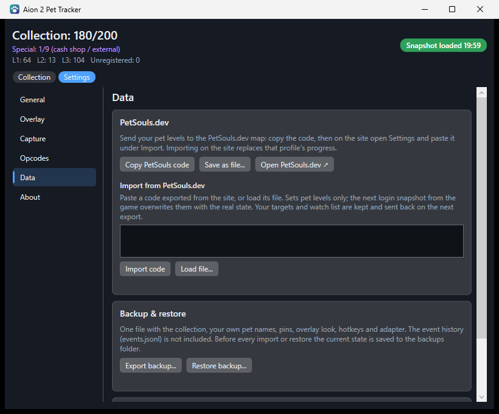

# Aion 2 Pet Tracker

A small Windows app for **Aion 2 (Global)** that keeps track of your pet collection while you play: every pet's level,
how many souls it still needs, and what you gained this session. Pin the pets you are working on and they show up in a
compact overlay on top of the game.



## Is it safe?

- It only **listens** to the data the game server sends to your PC, the same way a network monitor does.
- It never opens, reads or changes the game program or its files.
- It sends nothing to the internet. It only goes online when you click a link button, which opens
  [TH.GL](https://aion2.th.gl) or [PetSouls.dev](https://petsouls.dev/) in your browser.
- It needs no administrator rights.

This is an unofficial fan tool, not affiliated with or endorsed by NCSOFT.

## What you need

The app comes ready to run: download it from the
[Releases page](https://github.com/Gaikotsu2/Aion2-PetTracker/releases/latest). You do not need to install .NET or
build anything.

- [ ] **Windows 11, 64-bit.**
- [ ] **Npcap**: <https://npcap.com>. This is what lets the app see the game's network traffic. During installation:
  - **tick** "Install Npcap in WinPcap API-compatible Mode",
  - leave "Restrict Npcap driver's access to Administrators only" **unticked**.
- [ ] **Aion 2 in Borderless Windowed mode** (game display settings), so the overlay can appear above the game.

## Install

1. Install **Npcap** with the settings from the list above.
2. On the [Releases page](https://github.com/Gaikotsu2/Aion2-PetTracker/releases/latest), under **Assets**, download
   `Aion2-PetTracker-<version>-win-x64.zip`. Right-click the downloaded file → **Properties** → tick **Unblock** →
   **OK** (if you see no such box, skip this), then right-click it again → **Extract All**. Unblocking first keeps
   Windows from tagging every extracted file as "from the internet", which makes Smart App Control block shortcuts
   (such as a taskbar pin) made from the app.
3. Open the extracted folder (the one that contains `INSTALL.txt` and a `scripts` folder). Right-click an empty spot in
   the folder → **Open in Terminal**.
4. Copy this line into the terminal and press Enter:

   ```powershell
   powershell -ExecutionPolicy Bypass -File scripts\install.ps1 -NoPublish
   ```

   Windows blocks downloaded scripts by default; `-ExecutionPolicy Bypass` lets just this one script run, just this
   once. `-NoPublish` tells it to install the ready-made app instead of building it.
5. Start **Aion 2 Pet Tracker** from the Start Menu.

The release is digitally signed (publisher: Matthew Brubaker), so it also runs on PCs with Windows Smart App Control
turned on. To check, right-click `PetTracker.App.exe` → **Properties** → **Digital Signatures**.

Prefer not to install? You can also run `artifacts\PetTracker\PetTracker.App.exe` straight from the extracted folder
(keep the `data` folder next to it).

### Build from source instead

1. Install the **.NET 10 SDK** from Microsoft: <https://dotnet.microsoft.com/download/dotnet/10.0>. In the **SDK**
   column, pick **Windows x64** under "Installers".
2. Get the code: download `Aion2-PetTracker-<version>-source.zip` from the
   [Releases page](https://github.com/Gaikotsu2/Aion2-PetTracker/releases/latest) (or the green **Code** button →
   **Download ZIP**, or `git clone`) and extract it.
3. Open a terminal in the extracted folder and run the install command **without** `-NoPublish`:

   ```powershell
   powershell -ExecutionPolicy Bypass -File scripts\install.ps1
   ```

   The first build takes a minute or two.

> [!NOTE]
> **Smart App Control.** A build you compile yourself is not digitally signed. If Windows Smart App Control is turned
> on (Windows Security → App & browser control), Windows refuses to run it with error `0x800711C7`, and offers no way
> to make an exception for a single program. Use the signed release download instead, or turn Smart App Control off. See
> [docs/TECHNICAL.md](docs/TECHNICAL.md#smart-app-control).

## Using it

**First run.** Start the tracker, then log in to your character. The game sends your full pet list at login and the
collection window fills in. Without Npcap the tracker still opens and shows your last saved collection, with a banner
linking to the Npcap download.

**Collection window.** All your pets with genus, level, souls progress and this session's gains. Filter and sort with
the buttons at the top. Tick **Pin** to show a pet on the overlay; right-click a pet to rename it or open it on TH.GL.

**Overlay.** Shows your pinned pets, recent events such as souls gained and level-ups, and your souls per hour, above
the game.



Default hotkeys: **Ctrl+Shift+P** shows or hides the overlay, **Ctrl+Shift+L** turns click-through on and off (so
your clicks go to the game instead). Opacity, size and hotkeys are in Settings → Overlay.

**Settings.** Pick a section on the left.



- **General:** *Start with Windows* starts the tracker with only the overlay showing; the collection window waits in
  the system tray. *Reset session stats* starts the session counters from zero.
- **Overlay:** opacity, size and hotkeys.
- **Capture:** only needed with a VPN or ping reducer (see [Troubleshooting](#troubleshooting)).
- **Opcodes:** only needed after a game update (see [Troubleshooting](#troubleshooting)).
- **Data:** PetSouls.dev and backups, below.
- **Diagnostics:** a step-by-step guide to saving a report for support (see
  [Reporting a problem](#reporting-a-problem)).

**PetSouls.dev and backups.** Settings → Data.



- **Copy PetSouls code**, then on [PetSouls.dev](https://petsouls.dev/) open Settings → Import and paste it. You can
  also paste a code from the site into the tracker; the next time you log in, the game's real levels replace it.
- **Export backup** saves your collection, pet names, pins and settings in one file; **Restore backup** loads it,
  for example on another PC.

## Updating

Download the newest `win-x64` ZIP from the [Releases page](https://github.com/Gaikotsu2/Aion2-PetTracker/releases/latest),
extract it, and run the same install command again. If you build from source, get the new code (or `git pull`) and run
your install command again. Your collection and settings are kept.

## Uninstalling

From the extracted folder, run:

```powershell
powershell -ExecutionPolicy Bypass -File scripts\install.ps1 -Uninstall
```

This removes the app, its Start Menu shortcut and the "Start with Windows" setting, but keeps your collection in case
you come back. Add `-RemoveData` at the end to delete your collection too.

## Troubleshooting

**The banner says "Live capture is not running".** Npcap is missing, or it was installed with the
"Administrators only" option. Reinstall Npcap with the settings from [What you need](#what-you-need).

**The overlay is hidden behind the game.** Switch Aion 2 to Borderless Windowed mode.

**Nothing updates and the status says "Unknown version" after a game patch.** A patch can change how the game labels
its messages. The tracker usually spots the new labels itself and offers an **Apply** button in the banner. If it does
not, see [docs/PATCH-DAY.md](docs/PATCH-DAY.md), or wait for an update to this project.

**I use a VPN or ping reducer and nothing shows up.** In Settings → Capture, type part of the VPN adapter's name or its
IP address into the adapter box.

**Windows refuses to start the tracker (error `0x800711C7`).** You are running a build you compiled yourself, and
Windows Smart App Control blocks unsigned programs; see [Build from source instead](#build-from-source-instead). The
signed release download is not affected.

**Windows blocks `PetTracker.lnk` ("dangerous file extension from the web").** The shortcut, not the app, was
blocked: Smart App Control refuses any shortcut tagged as "from the internet", and a taskbar pin made from an app that
came out of a downloaded zip gets that tag. Unpin the shortcut, run the install command again (it removes the tag from
the installed app and from shortcuts that point at it), and pin again from the Start Menu entry **Aion 2 Pet Tracker**.
Or run this in a terminal, then pin again:

```powershell
Get-ChildItem "$env:LOCALAPPDATA\Programs\Aion2PetTracker" -Recurse | Unblock-File
```

**The install command fails with an error about `dotnet`.** You ran it without `-NoPublish`, so it tried to build the
app. Either add `-NoPublish` (when installing the ready-made download), or, when building from source, install the .NET
10 SDK, close the terminal, and open a new one.

### Reporting a problem

If something does not work, open Settings → Diagnostics. Leave the tracker running with the game open while the
problem happens, click **Save report...**, and attach the saved `.txt` file to your support request or GitHub issue
(**Copy report** puts the same text on the clipboard).

The tracker keeps technical logs for this in `%AppData%\Aion2PetTracker\logs`, and deletes anything older than 3 days.
They contain versions, Npcap and adapter checks, whether the game was found, decoder counters and opcode numbers. IP
addresses are replaced by tokens such as `ip#1(public)`, your Windows user name, computer name and profile folders are
removed, and packet contents, pet names and account data are never logged. Nothing is sent anywhere; the Settings page
shows a preview of exactly what a report contains, and you decide whether to share it.

## More technical information

- [docs/TECHNICAL.md](docs/TECHNICAL.md): building by hand, install script options, where your data is stored, how
  the pet data was collected.
- [docs/PROTOCOL.md](docs/PROTOCOL.md): what is known about the game's network messages.
- [docs/PATCH-DAY.md](docs/PATCH-DAY.md): getting the tracker working again after a game update.
- [docs/RESEARCH-GUIDE.md](docs/RESEARCH-GUIDE.md) and [docs/RESEARCH-PCAPNG.md](docs/RESEARCH-PCAPNG.md): helping
  with research recordings.

## Support the project (optional)

Aion 2 Pet Tracker is free and open source under the MIT license. If you find it useful and want to say thanks, you
can [leave a tip on Ko-fi](https://ko-fi.com/gaikotsu2). Tipping is entirely optional: every feature works exactly
the same whether or not you tip, with no locked features, reminders or supporter perks.

## Credits and license

Pet names and genera come from the community database [TH.GL](https://aion2.th.gl/db/pets).

Data: TH.GL (aion2.th.gl), game data © NCSOFT.

The source code is released under the [MIT License](LICENSE), © 2026 Gaikotsu2.

The pet catalog in `data/` is compiled from [TH.GL](https://aion2.th.gl) and community guides; AION 2 names and game
data belong to NCSOFT. This is an unofficial fan tool, not affiliated with or endorsed by NCSOFT.
